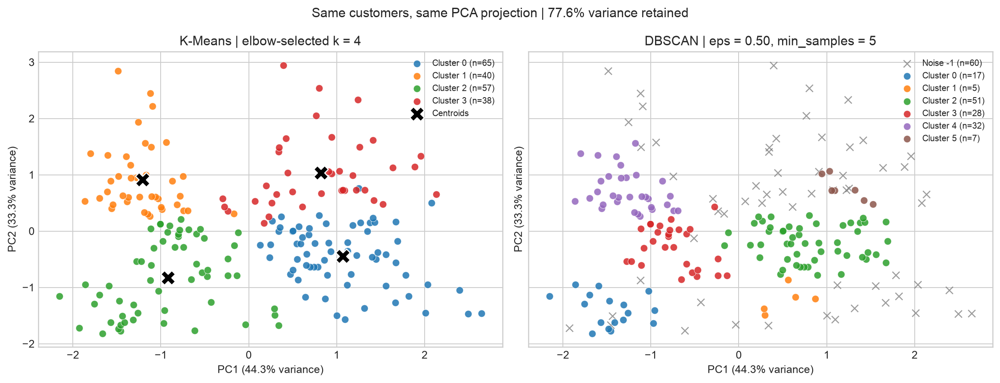

# Customer Segmentation: K-Means, DBSCAN and PCA

## Problem statement
Scale the features, then apply K-Means (use the elbow method to pick k) and DBSCAN
to the same data, and compare the groupings they produce. Use PCA to reduce the
data to 2 dimensions and visualize the clusters from both algorithms on a scatter plot.

## Dataset
[Mall Customer Segmentation Data by Vijay Choudhary](https://www.kaggle.com/datasets/vjchoudhary7/customer-segmentation-tutorial-in-python)
(200 customers; Mall_Customers.csv). Credit and original dataset licensing remain
with the source. The source data is downloaded or attached from Kaggle rather
than redistributed in this repository.

## Submission links
- [Executed notebook on GitHub](https://github.com/Bhanupriyacn/customer-segmentation-kmeans-dbscan/blob/main/customer_segmentation_kmeans_dbscan_pca.ipynb)
- [Public Kaggle notebook](https://www.kaggle.com/code/bhanupriyacn/customer-segmentation-kmeans-dbscan-pca)
- Notebook file: `customer_segmentation_kmeans_dbscan_pca.ipynb`

## Approach and results
The notebook standardizes Age, Annual Income and Spending Score with
StandardScaler. CustomerID is excluded, and Gender is retained for reference but
is not included in the numeric distance calculation. Both algorithms use the
same three-dimensional standardized matrix. One PCA fit supplies both 2D plots.

| Measure | Result |
|---|---:|
| Elbow-selected K-Means k | 4 |
| K-Means silhouette, all 200 customers | 0.4040 |
| DBSCAN eps / min_samples | 0.50 / 5 |
| DBSCAN groups, excluding noise | 6 |
| DBSCAN noise customers | 60 |
| DBSCAN coverage | 70.0% |
| DBSCAN silhouette, retained customers only | 0.4817 |
| K-Means silhouette, same retained subset | 0.4555 |
| ARI, retained customers only | 0.7318 |
| PCA variance retained in 2D | 77.57% |

K-Means assigns every customer to a segment. DBSCAN provides a complementary
view of dense groups and sparse customers, but rejects 30% of customers at this
radius and merges groups at larger radii. A higher silhouette computed after
excluding noise does not by itself imply a better segmentation. Cluster IDs are
arbitrary, and PCA projection can conceal separation in the third dimension.

## Visual comparison

## Files
- `customer_segmentation_kmeans_dbscan_pca.ipynb`: executed analysis with the problem statement, tables,
  elbow curve, neighbor-distance plot, PCA plots, and conclusion.
- `customer_cluster_assignments.csv`: one row per customer, both labels,
  explicit noise indicator and PCA coordinates.
- `clustering_comparison.csv`, `dbscan_sensitivity.csv`, `kmeans_elbow.csv`:
  numerical comparison and parameter diagnostics.
- `kmeans_cluster_profiles.csv`, `dbscan_cluster_profiles.csv`:
  group sizes and average original features.
- `results_summary.json`: machine-readable findings.
- `requirements.txt`: Python dependencies.

## Reproduce
Install the dependencies in `requirements.txt` and run the notebook from top to
bottom. On Kaggle, attach the linked dataset; no extra installation is needed.
Locally, put `Mall_Customers.csv` under `data/customer_segmentation/`, or let the
loader download the public Kaggle archive when internet is available. Python
3.10+ is recommended; explicit `n_init=20` and `random_state=42` make K-Means
reproducible. Library versions are printed in the notebook. Output files are
written to `/kaggle/working/customer_segmentation_outputs` on Kaggle.
